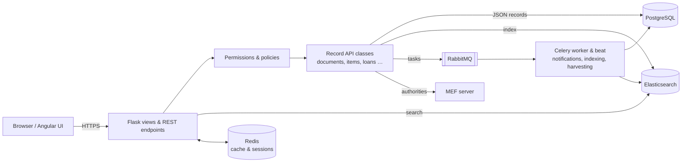

# Biblion

Biblion is an open source integrated library system (ILS) for heritage, public and school libraries and their networks, built on the Invenio framework.

## What This Project Does

Running a library network means keeping one shared catalogue, many libraries with their own rules, and thousands of patrons and loans in sync. Biblion is the backend that does that: it stores the bibliographic records, holdings and items of every library in a network, runs circulation and acquisitions, and exposes everything through a REST API and a public catalogue. It is meant for library networks (consortia) and for single libraries that need a full, multilingual ILS.

Main features:

- **Multi-organisation catalogue**: organisations, libraries and locations share one catalogue, with a global view and one view per organisation.
- **Cataloguing**: documents, holdings (including serial patterns and issues), items, local fields, collections and templates, validated with JSON Schemas.
- **Imports and conversion**: MARC21, UNIMARC and MARCXML converters (DNB, KUL, LoC, SLSP, UGent, BnF and others), external import services, Dublin Core and MARC21 export.
- **Authority entities**: links documents to persons, organisations, subjects and places from a MEF authority server, plus locally catalogued entities.
- **Circulation**: requests, checkouts, renewals, transits and returns, driven by circulation policies, item types and patron types, with library opening hours and exceptions.
- **Patrons**: patron accounts, subscriptions, fees and payments (patron transactions), and a public patron profile.
- **Notifications**: availability, due-soon, overdue, recall and transit notifications by email, with per-library templates.
- **Acquisitions**: vendors, budgets, accounts, orders, order lines and receipts.
- **Interlibrary loan (ILL)** requests from the public interface.
- **Statistics**: billing, librarian and configurable report statistics.
- **Interoperability**: SRU search, OAI-PMH server, OAuth2 tokens, a SIP2 self-check interface and API harvesting of e-books.
- **Operations**: operation logs, record deduplication, data migration tools, monitoring endpoints and scheduled tasks.
- **Translations**: English, French, German, Italian, Spanish and Dutch.

## How It Works

Biblion is an Invenio instance. Each resource (document, item, loan, patron, …) is a module with the same building blocks: a JSON Schema, an Elasticsearch mapping, a record API class, permissions, serializers and REST/UI views. Records are stored as JSON in PostgreSQL and indexed in Elasticsearch, which serves every search. Long or periodic work (indexing, notifications, harvesting, statistics) runs in Celery workers through RabbitMQ, with Redis as cache and session store.

The professional interface and the public search pages are an Angular application (the `@rero/rero-ils-ui` npm package) that `scripts/bootstrap` installs into the static folder. It talks to the REST API; Jinja templates in this repository render the page shells, the public detail views and the patron pages.

A typical request, for example a checkout from the professional interface, goes: Angular UI → `POST /api/item/checkout` → item view → permission check against the circulation policy → `Item`/`Loan` API (Invenio Circulation state machine) → PostgreSQL commit → Elasticsearch reindex → Celery task that sends the notification.

## License

Biblion is released under the GNU Affero General Public License v3.0 or later. See [LICENSE](LICENSE).
